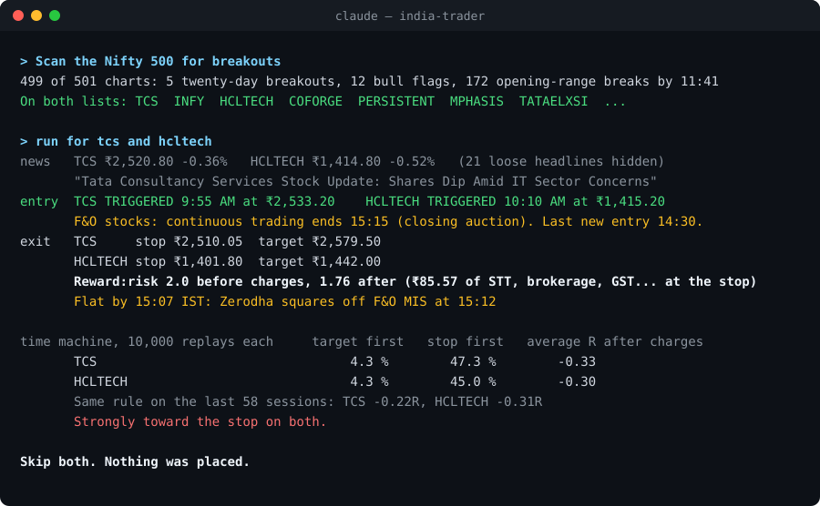

# India Trader: Claude skills for NSE & BSE

**Scan, plan, replay and size every Indian trade before a rupee moves. STT, stamp duty, circuit bands, your broker's square-off and the 3:15 closing auction are all built in.**

[](https://github.com/Adityaraj0421/india-trader/actions/workflows/tests.yml)


<p align="center"></p>

That's a real run (RELIANCE, 26 Oct 2026, from the test fixtures). The breakout triggered and the plan looked like a clean 2:1. After ₹89 of charges it was 1.75:1. Because RELIANCE is an F&O stock, its continuous trading ends at 3:15 and Zerodha squares it off at 3:12. Ten thousand replays from its own last 58 sessions said the stop comes first. **The best trade is often the one the tools talk you out of.**

Eleven [Claude Code](https://claude.com/claude-code) skills, plain Python, no API keys, nothing to `pip install`.

## Quick start

In Claude Code:

```
/plugin marketplace add Adityaraj0421/india-trader
/plugin install india-trader@india-trader
```

Or copy the folders so the commands are plain `/nse-scanner`:

```bash
git clone https://github.com/Adityaraj0421/india-trader.git
cp -r india-trader/nse-* ~/.claude/skills/
```

Then ask Claude things like:

- *"Scan the Nifty 500 for breakouts"*
- *"How did TCS's results look?"*
- *"Watch RELIANCE and tell me when to get in"*
- *"I have 2 lakh and want to risk ₹1,000 a trade, size it"*
- *"Who bought in today's bulk deals?"*

Python 3.8+ is all it needs. On Windows the skills use `py`.

## Why this exists

US trading tools get Indian markets wrong in ways that cost money:

| Indian reality | What the skills do |
| --- | --- |
| **Charges eat your R.** STT, stamp duty, exchange fees, SEBI fee and GST on every leg | Every stop, target, reward:risk and replay is shown *after* charges, broker by broker |
| **Closing auction (since 3 Aug 2026).** F&O stocks stop continuous trading at **3:15 PM**, and stop-loss orders aren't accepted in the auction | Each stock gets its own session end, switching back to 3:30 when SEBI's 7 Dec 2026 change lands |
| **MIS auto square-off.** Zerodha 3:12, Dhan 3:10, Groww 3:05 for F&O stocks | Your "flat by" time is always before **your** broker's square-off for **that** stock |
| **Circuit bands, BE/BZ trade-for-trade, GSM/ASM** | The risk check blocks orders outside the band, intraday orders in BE stocks, and MIS in surveillance stocks |
| **NSE holidays and Muhurat trading** | 2026 calendar from NSE's own circulars, with Muhurat on 8 Nov from 2:20 to 3:30 PM |
| **Results in crore and fiscal quarters** | Q1FY27 (Apr–Jun 2026) in ₹ crore, vs the same quarter last year. USD reporters like Infosys are labelled, with `--inr` to convert |
| **Delivery % matters to investors** | A bhavcopy scan for delivery spikes (accumulation) |

## The eleven

```
find        /nse-scanner ─▶ /nse-news
time        /nse-entry ─▶ /nse-exit ─▶ /nse-timemachine
size+guard  /nse-budget ─▶ /nse-risk ─▶ /nse-broker
alongside   /nse-alerts   /nse-analyst   /nse-bigmoney
```

| command | job |
| --- | --- |
| `/nse-scanner` | Nifty 50/100/200/500, Midcap 150, Smallcap 250, Bank Nifty or all NSE: 20-day breakouts, bull flags, oversold bounces, opening-range breakouts, delivery-% spikes |
| `/nse-news` | Google News (India edition) per stock, tagged: results, dividend, bonus, split, buyback, order win, block deal, SEBI, rating... Only new items, in IST |
| `/nse-entry` | Watches a setup bar by bar from 9:15 and calls the entry on a closed bar above the range or your level |
| `/nse-exit` | Stop and target to the 5-paise tick, reward:risk before and after charges, flat-by before your broker's square-off |
| `/nse-timemachine` | 10,000 replays of the rest of the day from the stock's own last 60 days, plus every past time the setup fired, in R net of charges |
| `/nse-budget` | Whole shares inside your max loss (charges included), position cap, cash and MIS margin. Also splits a CNC budget across stocks |
| `/nse-risk` | PASS or BLOCK against your rules: daily loss, trades per day, entry window, circuit band, BE series, GSM/ASM, no CNC short selling. Getting out is never blocked |
| `/nse-broker` | A paper ledger by default. Live tickets in your broker's own API format, after your typed yes and Claude's Allow card |
| `/nse-alerts` | Stop, target, % move, circuit proximity, opening bell and square-off reminders, plus "is NSE open?" |
| `/nse-analyst` | Quarterly results in ₹ crore: revenue, margins, profit, EPS, YoY, trailing twelve months, fiscal years. Missing quarters are shown as gaps, never invented |
| `/nse-bigmoney` | NSE bulk and block deals: who bought and sold what, flagged against your holdings and watchlist, with history |

## Brokers

Set `"broker"` in `nse/config.json`. Charges, square-off times, how stops are held and the ticket format all follow it.

| broker | key | live route |
| --- | --- | --- |
| Groww | `groww` | Official MCP server places orders |
| Zerodha (Kite) | `zerodha` | Hosted Kite MCP for GTT orders. Self-hosted kite-mcp-server or Kite Connect for regular orders |
| Angel One | `angelone` | SmartAPI ticket |
| ICICIdirect | `icicidirect` | Breeze API ticket (intraday is a manual ticket: Breeze refuses MIS) |
| Upstox | `upstox` | Upstox API ticket (its MCP is read-only) |
| Kotak Neo | `kotak` | Neo API ticket (its MCP is read-only) |
| HDFC Sky | `hdfcsky` | Manual ticket |
| Dhan | `dhan` | DhanHQ ticket, Forever OCO for delivery |
| SBI Securities | `sbi` | Manual ticket |
| Motilal Oswal | `motilal` | MO API ticket |

The top 10 by NSE active clients, September 2026. Every number has a source and a confidence tag in [docs/brokers.md](docs/brokers.md). Unverified square-off times use a cautious default and say so. If you can confirm one, [open an issue](../../issues/new?template=broker-data.yml).

## Safety by design

- **Paper by default.** Nothing reaches a broker unless you switch to live, type an explicit yes for that exact order, and click Allow on Claude's permission card.
- **Risk before every order.** The broker skill only shows an order that passed `/nse-risk` today, matched by fingerprint.
- **No keys in chat.** Broker logins happen in your browser or your broker's own MCP server.
- **No scraping.** The skills use Yahoo Finance, NSE's open archive files, niftyindices.com and Google News. They never touch the bot-protected nseindia.com or bseindia.com APIs, and they tell you where to look by hand for what only lives there.
- **SEBI's retail-algo framework.** Order APIs need a static IP, are capped at 10 orders per second, and require Algo IDs for automated strategies. This pack keeps a human approval on every order. Don't remove that.

## Data and freshness

Prices come from Yahoo Finance (free, unofficial, can lag). NSE's archive CSVs supply the equity list, bhavcopy, price bands, F&O list and bulk/block deals. The holiday list covers 2026 (NSE circulars NSE/CMTR/71775 and 72260). NSE publishes 2027 in December; add it to `nse/holidays.json` or send a PR. A weekly CI run catches stale calendars.

## Configure

```json
{
  "broker": "zerodha",
  "budget": 200000,
  "max_loss_per_trade_inr": 1000,
  "max_daily_loss_inr": 3000,
  "max_trades_per_day": 3,
  "flat_by": "15:10",
  "mis_leverage": 5,
  "paper": true
}
```

Full example: [`nse-budget/config.example.json`](nse-budget/config.example.json).

## Contributing

Good first contributions: confirm a broker's post-auction square-off time, add the 2027 NSE holidays, add a scanner setup, or improve a news tag. Read [CONTRIBUTING.md](CONTRIBUTING.md) and [docs/ARCHITECTURE.md](docs/ARCHITECTURE.md). All 526 tests run offline in about 20 seconds:

```bash
python -m unittest discover -s tests -p "test_nse_*.py"
```

## Credits

Built on Jake Schincariol's MIT-licensed US [day-trader-skill](https://github.com/Jakeschincariol/day-trader-skill), whose structure, rigor and honesty this pack keeps. The market layer is rebuilt for India.

## Not investment advice

These tools do arithmetic on public data. They are not investment advice, and the authors are not SEBI-registered investment advisers or research analysts. Markets can gap through any stop. Paper-trade first, and only risk money you can afford to lose.

If it saved you from one bad trade, a ⭐ helps other Indian traders find it.
